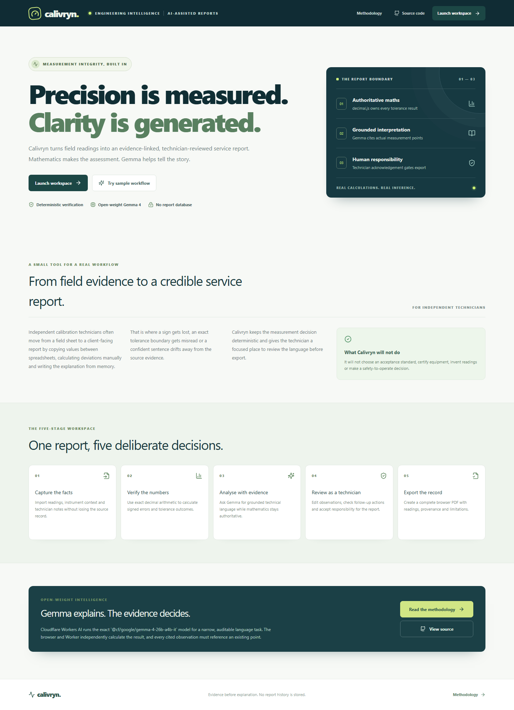
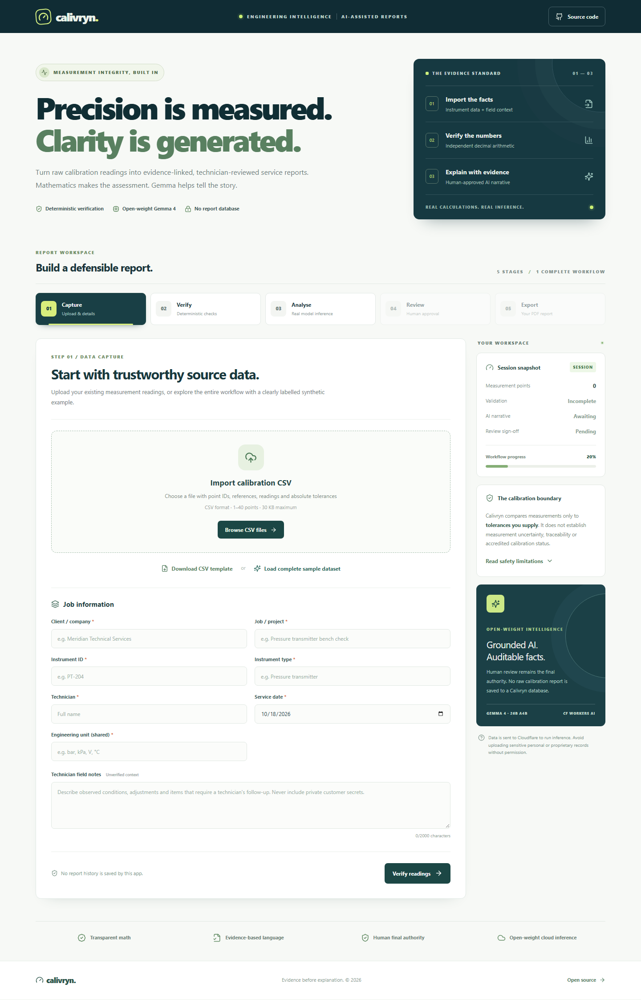
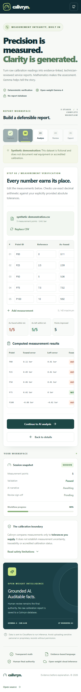

# Calivryn

**Precision is measured. Clarity is generated.**

[Open the production application](https://calivryn.delealufejoel.workers.dev) · [View the source repository](https://github.com/ometere123/Calivryn) · [Read the live smoke evidence](docs/evidence/live-smoke.json)

Calivryn is an open-source, AI-assisted calibration service-report preparation application for independent instrumentation and calibration technicians. It turns a CSV of readings into a deterministic, evidence-linked, technician-reviewed PDF report.

It is not an accredited calibration certificate generator, safety-to-operate authority, measurement-uncertainty calculator, or autonomous metrological approval system. A qualified technician remains responsible for the source records, supplied tolerances, interpretation, and final report.

## Why this exists

After a field or bench check, a small calibration team still has to move from readings to a client-facing service report. Copying values between spreadsheets, calculating deviations manually, and writing the explanation from memory makes it easy to lose a sign, misread an exact tolerance boundary, or let prose outrun the evidence.

Calivryn keeps the numerical decision deterministic and gives the technician a focused review gate before export. The target customer is an independent calibration technician, instrumentation contractor, or small service team. A believable pricing hypothesis is a low-cost pay-per-report or small monthly workspace plan priced below the time saved on repetitive report preparation. There are no paying-customer, revenue, or production calibration-record claims in this repository.

## The seven-route application

The product is a dedicated landing page, five report-workspace views, and a methodology page. The workspace is one in-memory session shared by the five `/app/*` routes.

| Route | Purpose |
| --- | --- |
| `/` | Concise product landing page, customer problem, five-stage boundary, and links into the workspace, methodology, and source. |
| `/app/capture` | CSV upload, downloadable template, synthetic demonstration data, job/instrument metadata, and technician notes. |
| `/app/verify` | Editable 1–40 point table, exact signed/absolute errors, tolerance checks, summary metrics, and validation errors. |
| `/app/analyse` | Real Cloudflare Workers AI request using the pinned Gemma 4 model, with loading, evidence, and provider-failure states. |
| `/app/review` | Editable summary, point-referenced observations, technician follow-up actions, and explicit acknowledgement. |
| `/app/export` | Report preview, export eligibility, browser-generated PDF, and start-a-new-report action. |
| `/methodology` | Calculation, AI boundary, human responsibility, privacy, and technical-method explanation. |

The application shell provides a shared header, desktop sidebar, compact mobile navigation, active-route indicators, completion states, contextual status, consistent errors, focusable scroll regions, and scroll-to-top on route changes. React Router 7 handles real browser routes, so browser Back and Forward preserve a valid session while the application remains mounted.

Report state is deliberately held in memory only. A full reload of a nested workspace route starts a fresh session and safely redirects to Capture with an explanation. The application never reconstructs fake results, uses localStorage/sessionStorage/cookies, or stores reports on the server. Editing source readings or relevant metadata invalidates analysis, narrative edits, review acknowledgement, and export eligibility.

## Capture → Verify → Analyse → Review → Export

1. **Capture** — import a real CSV, download the standard template, or load the clearly labelled synthetic dataset. Enter required job, instrument, date, shared unit, and technician-note metadata.
2. **Verify** — edit 1–40 points in one engineering unit. Inspect precise signed errors, absolute errors, as-found/as-left tolerance status, and improvement or deterioration.
3. **Analyse** — send validated evidence and untrusted notes to the native Cloudflare `env.AI.run()` binding using `@cf/google/gemma-4-26b-a4b-it`.
4. **Review** — edit the model's summary, point-referenced observations, and review items. A technician must acknowledge the narrative.
5. **Export** — generate a complete, multi-page PDF in the browser with metadata, every reading, full-precision results, evidence-linked interpretation, notes, provenance, acknowledgement, and limitations.

Gemma never determines numerical pass/fail, invents measurements, selects acceptance standards, or certifies equipment. The browser previews the calculation and the Worker independently validates and recalculates it. The browser compares the returned calculation with its own result before Review, and the PDF exporter checks again before export.

## Screenshots

These screenshots are captured from the real application using the synthetic demonstration dataset. They are interface evidence, not customer records.







Additional [desktop, tablet, and mobile captures](docs/screenshots) and the [recording plan](docs/DEMO_PLAN.md) are included for a truthful demonstration.

## Architecture and locked stack

```text
React + React Router 7 + Vite + Tailwind CSS browser UI
  ├─ in-memory SessionProvider shared by the five workspace routes
  ├─ PapaParse CSV input + Zod validation
  ├─ decimal.js deterministic calculation preview
  ├─ same-origin POST /api/analyze
  │    └─ Cloudflare Worker
  │         ├─ origin, media-type, UTF-8 and request-size checks
  │         ├─ strict Zod validation + independent decimal.js calculation
  │         ├─ Cloudflare rate-limit bindings
  │         └─ native env.AI.run(@cf/google/gemma-4-26b-a4b-it)
  └─ jsPDF browser export after technician acknowledgement
```

The Worker and React Static Assets are deployed as one Cloudflare application using the official Cloudflare Vite plugin and project-local Wrangler. There is no database, authentication, report history, external AI API, Vercel, Railway, Ollama, blockchain, payment flow, or paid infrastructure.

Technology: TypeScript, React 19, React Router 7, Vite 7, Tailwind CSS 4, Cloudflare Workers/Static Assets, Workers AI, PapaParse, `decimal.js`, Zod, jsPDF, Vitest 5, Playwright, npm, Wrangler 4, and GitHub Actions.

See [the architecture notes](docs/ARCHITECTURE.md) and [security and metrological boundaries](docs/SECURITY.md).

## Deterministic calculation method

For every point:

```text
signed error      = measured reading - reference
absolute error    = |signed error|
within tolerance  = absolute error <= positive, technician-supplied tolerance
change            = improved | unchanged | deteriorated
overall result    = every point is within its own tolerance
```

`decimal.js` is used in the browser and Worker so exact boundaries, negative readings, and very small permitted decimals are compared without binary floating-point surprises. Scientific notation, `NaN`, `Infinity`, blank numbers, zero/negative tolerances, duplicate or case-variant point IDs, unexpected properties, and out-of-range data are rejected. No model response can override the calculation.

## CSV format

The header must contain exactly these five fields, in any order:

```csv
point_id,reference,as_found,as_left,tolerance
P00,0,0.11,0.01,0.05
P25,2.5,2.59,2.52,0.05
```

Limits are 1–40 rows and 30 KB per CSV. IDs are unique case-insensitively. Every point uses the one engineering unit supplied in the job metadata. Tolerances are positive absolute values in that same unit. Units support common Unicode engineering notation such as `mΩ/°C·s⁻¹` and are printed without numerical rounding.

## API contract

All API responses are JSON, `Cache-Control: no-store`, and served from the same Worker hostname.

### `GET /api/health`

Returns routing/configuration metadata:

```json
{
  "ok": true,
  "model": "@cf/google/gemma-4-26b-a4b-it",
  "inference": "LIVE_BINDING_REQUIRED",
  "storage": false
}
```

Health does not call the model and is not proof of live inference compatibility.

### `POST /api/analyze`

Accepts `{ metadata, points }` using the CSV grammar above. A successful response contains `model`, `generatedAt`, an authoritative `calculation`, and a schema-validated `narrative` with a summary, point-ID observations, and point-ID review items. Technician notes are sent as untrusted context.

The Worker returns explicit failures: `400` malformed JSON/UTF-8, `403` unauthorized origin, `413` oversized body, `415` wrong content type, `422` invalid report, `429` rate limited, `502` malformed or ungrounded model output, and `503` unavailable provider/configuration. Provider stack traces and report contents are not returned or logged by application code.

The coarse IP limiter and shared edge throttle are abuse controls, not a guaranteed account-wide daily spending cap. Cloudflare location-level behaviour and provider quotas can vary.

## Privacy, security, and limits

- Readings, metadata, and notes stay in browser memory until analysis is requested.
- Analysis data is transmitted to Cloudflare Workers AI. Cloudflare and model-provider retention, logging, and processing policies remain applicable. Calivryn does not claim local-only processing or zero provider-side retention.
- React renders user and model text as escaped text. There are no embedded credentials, client-side secrets, unsafe HTML sinks, or unwanted external requests.
- Strict schemas, request-size limits, media-type enforcement, origin protection, rate limiting, response validation, point-ID grounding, security headers, and fail-closed provider errors are implemented.
- No report database, account system, analytics store, cookie, persistent report history, or server-side report storage exists.
- The PDF is service-report preparation only. It does not establish traceability, uncertainty, accreditation, standards selection, compliance, or safe operation.
- Do not upload identifiable, confidential, or proprietary customer data without appropriate permission and a privacy review.

See [docs/SECURITY.md](docs/SECURITY.md) for the threat model, adversarial cases, resource restrictions, and residual risk.

## Local development and tests

Requirements: Node.js 22+ and npm.

```bash
npm ci
npm run dev
npm run typecheck
npm run test
npm run test:e2e
npm run build
npm audit --omit=dev
npm audit
```

`npm run test` covers deterministic mathematics, CSV parsing, Worker validation and failure handling, model-response grounding, review invalidation, and PDF safety. `npm run test:e2e` is a credential-free Playwright suite with intercepted responses; it is not live inference evidence. `npm run screenshots` captures the public and initial workspace routes locally at desktop, tablet, and mobile widths. `npm run live-smoke` is the separate production evidence command and makes one genuine model call.

The verified local source currently has 29 passing Vitest tests across four files and 3 passing Playwright tests. TypeScript, the production build, and both npm audit modes pass with zero vulnerabilities. GitHub Actions runs the same lockfile-based install, checks, build, and browser suite.

## Cloudflare deployment

The committed `wrangler.jsonc` configures the native AI binding, Static Assets SPA fallback, two simple rate-limit bindings, and redacted observability. Reproduce deployment with:

```bash
npm ci
npx wrangler login
npm run deploy
```

The public application is [calivryn.delealufejoel.workers.dev](https://calivryn.delealufejoel.workers.dev). Deployment does not enable billing or paid overages. The account owner confirms that this project is on Cloudflare's Free plan and has never paid for Cloudflare; that is an owner-confirmed account fact, not an independent billing-API verification. A missing billing-read permission prevents that API confirmation. Workers AI capacity and allocation remain provider-level constraints.

For a genuine release smoke test:

```bash
npm run live-smoke
```

The script checks the seven SPA routes, loads the synthetic dataset in a real browser, calls the live Worker/AI binding, records the exact model and calculation, captures responsive screens, acknowledges review, downloads the PDF, and probes origin/content-type protections plus a small safe request sequence. It does not induce a provider outage or claim that a non-429 sequence proves an account-wide quota. Evidence is stored in [docs/evidence/live-smoke.json](docs/evidence/live-smoke.json) and [docs/evidence/live-smoke-report.pdf](docs/evidence/live-smoke-report.pdf).

## Release and submission evidence

- [Final application CI run](https://github.com/ometere123/Calivryn/actions/runs/39174887202) — green source-matched checks for the verified application release.
- [Live smoke JSON](docs/evidence/live-smoke.json) — model, route, calculation, failure, and export evidence.
- [Generated sample PDF](docs/evidence/live-smoke-report.pdf) — browser export from the synthetic workflow.
- [Screenshots](docs/screenshots) — real landing, workspace, responsive, review, and export views.
- [Final technical test plan](docs/TEST_PLAN.md) and [security record](docs/SECURITY.md).
- [DEV submission copy](docs/DEV_SUBMISSION.md) and [authentic demonstration plan](docs/DEMO_PLAN.md).

## DEV Hacktoberfest Week 2 submission

The ready-to-publish article follows the official Week 2 submission structure: What I built, Demo, Code, How I built it, Why does open innovation matter?, and Prize categories. Optional agent-session and first-user sections are omitted because no authentic session link or paying first user is claimed.

- [Complete DEV submission copy](docs/DEV_SUBMISSION.md)
- [Demonstration plan](docs/DEMO_PLAN.md)
- Intended category target: **Best Use of Gemma**, within the Week 2 **Side Hustle** theme, without claiming eligibility, judging outcome, customer adoption, or victory.

## Licence and model terms

Project-owned source is MIT-licensed in [LICENSE](LICENSE). Google's Gemma weights, usage conditions, and Cloudflare Workers AI service terms are separate and are not relicensed by this repository. Review the current [Gemma terms](https://ai.google.dev/gemma/terms) and [Cloudflare Gemma 4 documentation](https://developers.cloudflare.com/workers-ai/models/gemma-4-26b-a4b-it/) before commercial use.
